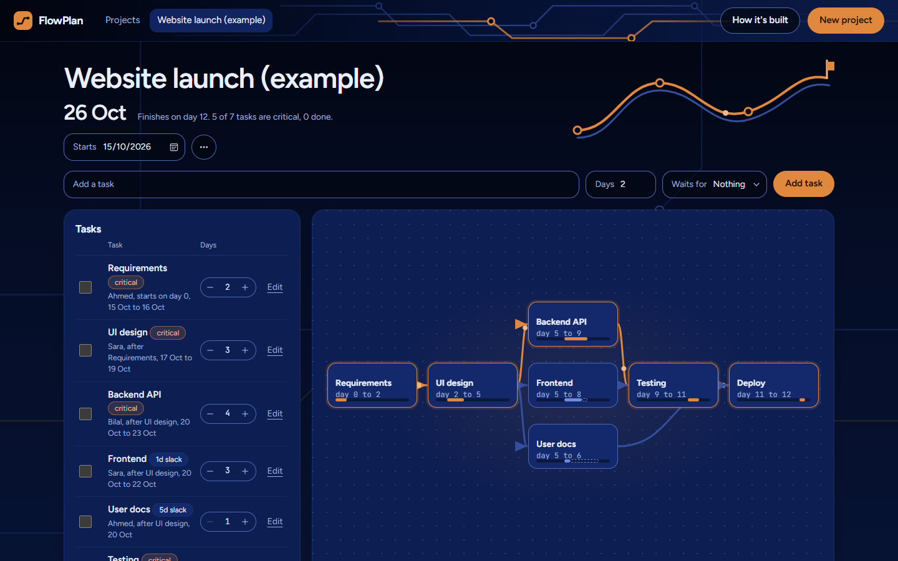
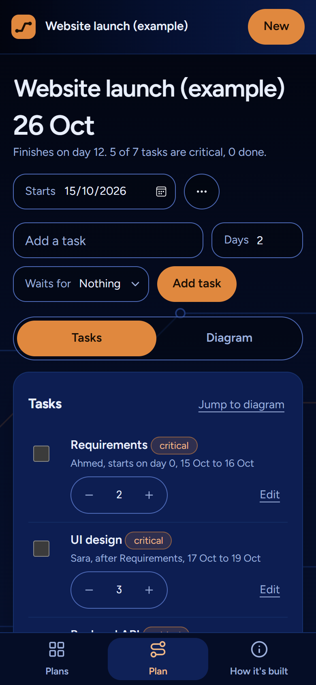
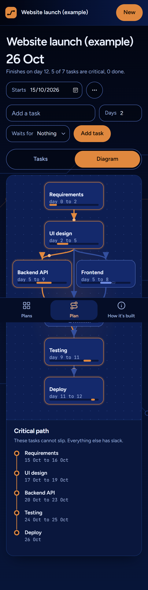
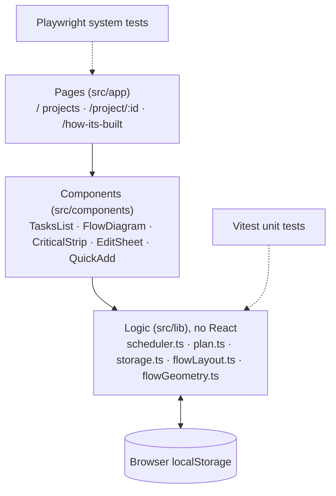
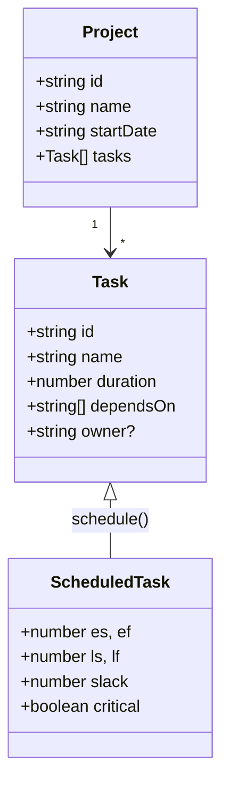
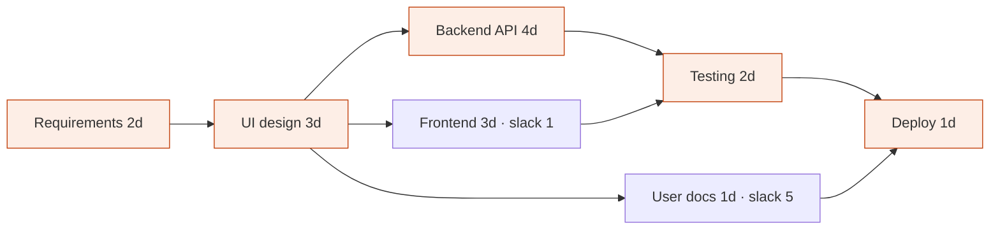

# FlowPlan

> Small teams miss deadlines because their tools list tasks but can't show which ones control the deadline. FlowPlan finds the critical path and shows how far every other task can slip.

[](https://github.com/ahmed-malikk/FlowPlan/actions/workflows/test.yml)

**Live:** [flow-plan-five.vercel.app](https://flow-plan-five.vercel.app/) · **PRD:** [docs/PRD.md](docs/PRD.md) · **Tests:** [plan](docs/test-plan.md) · [report](docs/test-report.md) · **Lessons:** [lessons learned](docs/lessons-learned.md) · **Board:** [issues](https://github.com/ahmed-malikk/FlowPlan/issues?q=is%3Aissue)



**Try it in 30 seconds:** open the live link and open the example project. Press **+** on *Backend API* (a critical task) and watch the finish date move and a note say the critical path changed, then press **+** on *Frontend* (1 day of slack) and watch the finish date stay put. No sign-up needed.

## Why I built it

Trello lists, WhatsApp threads and spreadsheets can't answer the question that matters most to a deadline: *if this task is late, does the delivery date move?* Tools that can, like MS Project, are heavy and paid for a 3–10 person team. FlowPlan is the first project of my 3-week, 10-project portfolio, and its first real user is me: I used it to plan that portfolio sprint ([#10](https://github.com/ahmed-malikk/FlowPlan/issues/10)).

## Features

- **Tasks with dependencies:** name, duration in whole days, optional owner and notes, and the tasks it waits for. Add them from one bar at the top; edit in a dialog; delete with Undo.
- **Loop detection:** a change that would create a circular dependency is blocked, and the message names the loop (`A → B → C → A`). In the picker, an option that would create a loop is switched off and says which loop.
- **Critical path and slack:** critical tasks are amber everywhere; every other task shows how many days it can slip. A strip under the diagram lists the critical path in order.
- **Flow diagram:** every task is a station on a route, arrows join the tasks that wait for each other, and pointing at a task lights up what it waits for and what waits for it.
- **What-if:** the − and + on any duration update the finish date at once; if the edit changes the critical path, a note says so.
- **Done and progress:** tick tasks done; the schedule never changes, only the progress.
- **Phone layout of its own:** a Tasks | Diagram switch, a bottom tab bar, a diagram that runs top to bottom, and swipe on a row to mark it done.
- **First visit:** helpful empty states, a short tour shown once, and a one-time tip that explains what "slack" means.
- **Saved in the browser:** no account; projects survive closing the tab. Print or save as PDF gives a light page with the tasks and the timeline.
- **A "How it's built" page** with the story, the problem, a step-by-step explainer of the algorithm, the stack, architecture, tests and links.

| Phone: tasks | Phone: diagram |
|---|---|
|  |  |

## Tech stack

Next.js 16 · React 19 · TypeScript (strict) · Tailwind CSS 4 · shadcn/ui on Radix UI · Figtree and JetBrains Mono · Lucide icons · localStorage · Vitest · Playwright · GitHub Actions · Vercel

## Architecture

Three layers. The bottom layer is pure TypeScript with no React, so the scheduling logic can be tested and explained on its own.





## The core algorithm

FlowPlan uses the **Critical Path Method**. All of it is in [`src/lib/scheduler.ts`](src/lib/scheduler.ts), and the app's "How it's built" page steps through it on the example plan:

1. **Build the graph:** each task is a node; "B waits for A" is an arrow A → B.
2. **Topological sort (Kahn's algorithm):** repeatedly take a task whose prerequisites are all placed. If some tasks can never be placed, they wait for each other: that's a loop, and FlowPlan walks back through them to name it.
3. **Forward pass:** earliest start = the latest earliest-finish among the tasks it waits for.
4. **Backward pass:** latest finish = the earliest latest-start among the tasks waiting for it.

**Slack = latest start − earliest start.** Tasks with zero slack are the critical path: delay any one of them and the project is late.

**Worked example** (the example project): 7 tasks, **12 days**, critical path **Requirements → UI design → Backend API → Testing → Deploy**.



Testing can't start until Backend (day 9) and Frontend (day 8) are both done, so Frontend has 1 day of slack. If Backend slips 2 days, the project moves from day 12 to day 14.

**Complexity:** every step visits each task (V) and dependency (E) a constant number of times, so the whole calculation is **O(V + E)** time and space. That's fast enough to recalculate on every keystroke.

## Design decisions

| Decision | Why | Trade-off |
|---|---|---|
| Scheduling logic in pure functions with no React | Easy to unit test and to explain; it survived a complete interface redesign untouched | A little more wiring between layers |
| Kahn's algorithm for ordering | Gives the order *and* the loop check in one iterative pass, no recursion limits | Naming the exact loop needs a small extra walk |
| Validate the *proposed* plan before saving | A change that would create a loop is never stored, so saved data is always a valid graph | Every save runs the sort (cheap at O(V + E)) |
| Recalculate on every change, no caching | O(V + E) is instant for hundreds of tasks; simpler code | Would need memoising for very large plans |
| The diagram's layout is a pure function too | Where each station goes (and how it shrinks to fit) is unit tested without a browser | A second small layer between the schedule and the screen |
| localStorage, no backend | Zero cost and setup; data stays private; enough for single-user use | No sharing or sync between devices |
| Days as integers, dates only for display (UTC) | No time-zone or daylight-saving bugs | Weekends and holidays aren't skipped yet |
| Dependencies stored by id, not name | Renaming a task never breaks links | Ids are meaningless when reading raw data |
| Dark theme with checked colour pairs | A unit test measures the contrast of each text and background pair against WCAG | Dark only; there is no light theme (printing switches to a light page) |
| A phone layout of its own | Phones get their own order and gestures instead of a squeezed desktop page | Two layouts to test |

## How I ran it as a project

- **PRD written before coding:** problem, target user, goals and non-goals, 6 user stories with acceptance criteria, success metrics, risks ([docs/PRD.md](docs/PRD.md))
- **GitHub issues for every piece of work**, closed by a `Closes #n` commit: 16 for version 1 and 14 for the redesign, with a design system, app shell, projects page, workspace, task list, diagram, edit dialog, critical path, onboarding, the "How it's built" page, print styles, system tests and this documentation
- **One commit per feature** in the `feat:` / `fix:` / `test:` / `docs:` style; CI runs typecheck, unit tests and build on every push
- **Test plan and test report** with traceability from each story to its tests ([plan](docs/test-plan.md), [report](docs/test-report.md))
- **Honest plan vs actual:** in version 1, features were committed in one batch at the end of the build and the issue board was published after it. The redesign was built one issue and one commit at a time.

## Results

- **Correctness:** the scheduler matches hand calculations for the worked example (every ES/EF/LS/LF/slack value), three further projects and nine edge cases. In all, **129 unit tests** pass, covering the scheduler, plan helpers, the diagram's layout and geometry, and the contrast of every colour pair.
- **System tests:** 33 user journeys in desktop Edge, desktop Chrome and a 375 px phone view: **93 passed, 6 skipped by design, 0 failed** on the local production build (v2.0.1, 2026-10-15); the 86 of v2.0 also passed on the live Vercel site. The 4 skipped cases only apply to one kind of device: the phone-only swipe test is skipped on desktop, and the two hover-only tests are skipped on the phone view.
- **Bugs found and fixed:** testing found 2 phone-only layout defects in version 1 ([#11](https://github.com/ahmed-malikk/FlowPlan/issues/11), [#13](https://github.com/ahmed-malikk/FlowPlan/issues/13)) and, in the redesign, a plan with no tasks hiding its empty state on a phone ([#40](https://github.com/ahmed-malikk/FlowPlan/issues/40)); all are fixed and covered by tests.
- **Real use, user #1 is me:** I planned my own 3-week, 11-item portfolio sprint in FlowPlan ([#10](https://github.com/ahmed-malikk/FlowPlan/issues/10)). It finished **Mon 26 Oct 2026, day 21**, exactly matching my hand calculation, with **all 11 items critical**. Planned with dependencies alone, the same work takes **12 days**. The 9-day gap is caused by one person doing everything, not by dependencies. So any slip moves my deadline, my single buffer day matters, and per-person overload warnings are the most useful next feature.
- **Still to measure:** usability with 3 first-time users (target: a 6-task plan in under 5 minutes). Results will be added here when they're real.

## What I'd do next

- Warn when one person has overlapping tasks (my own sprint plan showed why: by dependencies alone it's 12 days, but as one person it's 21)
- A working calendar that skips weekends and holidays
- Accounts and a shareable read-only link for clients (Supabase)
- Track actual vs planned progress and flag tasks that are eating their slack
- Run the Playwright tests in CI, and add Safari/Firefox

## Run locally

```bash
npm install
npm run dev        # http://localhost:3000
npm test           # Vitest unit tests: scheduler, plan helpers, layout, colours, storage
npm run test:e2e   # Playwright system tests in Edge, Chrome and a 375px phone view
npm run typecheck
npm run build
```

- `npm run test:e2e` uses the Edge and Chrome already installed on the machine. To run the same tests against the live site: `E2E_BASE_URL=https://flow-plan-five.vercel.app npx playwright test`.
- **Testing on a real phone:** `npm run build`, then `npx next start -H 0.0.0.0`, then open `http://<your-laptop-ip>:3000` on the phone (same Wi-Fi). `npm run dev` only serves its scripts to `localhost`, so it won't work on a phone.

### Project structure

```
src/app/page.tsx                projects page
src/app/project/[id]/page.tsx   the workspace: tasks, diagram, critical path
src/app/how-its-built/          the "How it's built" page
src/app/globals.css             design tokens, motion and print styles
src/components/                 TasksList, FlowDiagram, CriticalStrip, EditSheet, QuickAdd, Tour, ...
src/components/ui/              shadcn-style Button, Input, Dialog, Popover, ...
src/content/howItsBuilt.ts      the wording of the "How it's built" page
src/lib/scheduler.ts            graph, cycle check, CPM (the key file)
src/lib/plan.ts                 validation, safe edits, day → date conversion
src/lib/storage.ts              save/load in localStorage
src/lib/flowLayout.ts           which task sits where in the diagram
src/lib/flowGeometry.ts         sizes and arrow paths, shrinking to fit
src/lib/*.test.ts               Vitest unit tests
e2e/flowplan.spec.ts            Playwright system tests (ST-01 … ST-30)
docs/                           PRD, test plan, test report, lessons, screenshots
```

## Credits

Figtree and JetBrains Mono (SIL Open Font License). Lucide icons (ISC). Radix UI, shadcn/ui, Tailwind CSS and Sonner (MIT).
